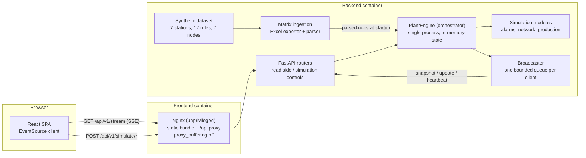

# PlantPulse Live-Ops

[](https://github.com/d-gallardo-1/plantpulse-live-ops/actions/workflows/ci.yml)

**On-premises cause-and-effect diagnostics for automated production lines, streamed live to a control-room display.**

<!-- TODO: Insert 15s demo GIF here (trigger ALM-207 and show the station, trace matrix and interlock update live) -->

> **Reference demo.** All telemetry is simulated and every station, tag, I/O address,
> threshold and IP address is synthetic. The application is not connected to a PLC or to
> any plant hardware, and it is not a safety system.

## The problem

In heavy industrial plants the engineering knowledge needed to diagnose a stoppage is
spread across static spreadsheets: alarm lists, Cause & Effect matrices, instrument
indexes, PLC I/O schedules and junction box schedules. When an alarm trips, someone has
to cross-reference those files by hand while the line is stopped.

PlantPulse shows what the unified version looks like. One alarm resolves immediately to
its full hardware trace:

`Alarm code → Root cause → Interlock effect → Instrument tag → PLC I/O → Cabinet / junction box → Recommended field action`

## Key features

- **Live Alarm Diagnostics.** Active alarms arrive over Server-Sent Events and each card
  opens with its seven-step hardware traceability chain.
- **Alarm lifecycle.** An alarm is raised, acknowledged by an operator and then cleared.
  Unacknowledged alarms draw attention; acknowledged ones stay visible until cleared, and
  cleared ones move to a history table with all three timestamps.
- **Interactive line topology.** Seven stations in process order; selecting one filters
  the diagnostic feed.
- **Fault injection controls.** Trigger specific alarms, clear them, reset the line, and
  pause the background event generator so a manual demo is never overwritten.
- **Cause & Effect Matrix Explorer.** Instant search by alarm code, PLC address, device
  tag, cabinet or junction box. Punctuation is ignored, so `alm203` finds `ALM-203`, and tags match
  from a word boundary, so `cp-01` does not return `SCP-01`.
- **Spreadsheet ingestion.** The matrix served by the API is produced by parsing a
  multi-header Excel workbook, the same shape as a legacy engineering matrix. Download
  the workbook, edit a row in Excel, upload it (`.xlsx`, 2 MB limit) and the change is
  live. Invalid workbooks are rejected with the row and column that failed.
- **Network Watchdog.** Latency and packet-loss telemetry for seven PLC, I/O, drive, HMI
  and gateway nodes, with per-node link overrides.
- **Runs offline.** No CDN, no web fonts, no external API. Everything is served from the
  two containers.
- **Accessible status.** Every status pairs colour with an icon and a text label, and
  animations respect the reduced-motion preference.

## Architecture



Every SSE event carries one complete plant snapshot. A client that connects late, or
reconnects after a drop, is consistent again after a single message.

More detail, including the security posture and what a real deployment would need:
[docs/ARCHITECTURE_AND_SECURITY.md](docs/ARCHITECTURE_AND_SECURITY.md).

## Quickstart

### With Docker

```bash
git clone https://github.com/d-gallardo-1/plantpulse-live-ops.git
cd plantpulse-live-ops
docker compose up --build
```

Then open <http://127.0.0.1:8080>.

### Without Docker

Requires Python 3.13+ and Node.js 20.19+. Python 3.13 is the version used by the
container image and by CI; the start scripts check it before doing anything else.

```powershell
# Windows. Unsigned scripts are blocked by default, so the policy is relaxed
# for this single run only.
powershell -ExecutionPolicy Bypass -File .\run_local.ps1
```

```bash
# Linux, macOS, WSL
./run_local.sh
```

Then open <http://127.0.0.1:5173>.

### Two-minute tour

1. Turn **Auto-Cycle Simulation** off in the demo controls.
2. Press **Trigger ALM-207 (Hopper Gate Stuck)**. Station 03 turns critical and the
   alarm card shows its instrument `ZS-309`, PLC input `R2.S2.DI07`, cabinet `CP-03`,
   junction box `JB-309` and the interlock that locks carousel advance.
3. Select station 03 in the topology to filter the feed, then open **Cause & Effect
   Matrix** and search for `scp-01` to see both safety-panel alarms.
4. Open **Network Watchdog**, drop the link of `GW-EDGE-01`, and watch the gateway
   latency KPI change.
5. Back on **Live Operations**, press **Acknowledge** on an alarm, then clear it and
   find it in **Alarm History** with its raised, acknowledged and cleared times.
6. In **Cause & Effect Matrix**, download the workbook, change an alarm title in Excel
   and upload it. Trigger that alarm to see the new title.
7. Press **Reset All Faults**.

## UI layout

| Area | Content |
| --- | --- |
| Top bar | Facility name, "simulated demo data" badge, view tabs, clock |
| KPI ribbon | Line OEE, cycle output vs shift target, active interlocks, gateway latency, SSE stream health |
| Live ticker | The three most recent plant events |
| Live Operations | Line topology, diagnostic feed with traceability matrices, alarm history, demo controls, event log |
| Cause & Effect Matrix | Spreadsheet download, upload and restore, search box, station filter, one relationship card per rule |
| Network Watchdog | One card per node with status, latency, packet loss and latency trend |

## API

Base path: `/api/v1`. The OpenAPI schema is served at `/api/v1/openapi.json`.

| Method | Path | Purpose |
| --- | --- | --- |
| GET | `/health` | Liveness probe |
| GET | `/state` | Current plant snapshot |
| GET | `/matrix?q=&station=` | Search the Cause & Effect matrix |
| GET | `/matrix/export-sample` | Download the current matrix as a multi-header `.xlsx` |
| POST | `/matrix/upload?filename=` | Replace the matrix; raw `.xlsx` body, 2 MB limit |
| POST | `/matrix/restore-default` | Restore the built-in sample matrix |
| GET | `/stream` | Server-Sent Events: `snapshot`, `update`, `heartbeat` |
| POST | `/alarms/{alarm_code}/acknowledge` | Acknowledge an active alarm |
| POST | `/simulate/trigger/{alarm_code}` | Inject a fault |
| POST | `/simulate/clear/{alarm_code}` | Clear one fault |
| POST | `/simulate/reset` | Clear all faults and network overrides |
| POST | `/simulate/auto-cycle` | Body `{"enabled": bool}`: toggle background events |
| POST | `/simulate/network/{node_id}` | Body `{"status": "ONLINE" \| "DEGRADED" \| "OFFLINE"}` |

Watch the stream from a terminal:

```bash
curl -N "http://127.0.0.1:8080/api/v1/stream?max_events=3"
```

## Repository layout

Orchestrator modules compose small, single-purpose modules. Source files are limited to
200 lines, and CI enforces it with `scripts/check_file_length.py`.

```text
backend/app/
  main.py              orchestrator: app factory, lifespan, routers
  engine.py            orchestrator: composes the simulation modules
  mock_data.py         orchestrator: assembles the synthetic dataset
  matrix_parser.py     orchestrator: Excel round trip and CLI
  api/                 read, matrix, alarm and simulation routes; schemas
  simulation/          alarms, network, production, events, broadcaster, views
  matrix/              layout, exporter, parser, upload validation
  data/                stations, rules per line area, network nodes
  sse.py, config.py, models.py
backend/tests/         matrix, upload, read API, simulation API, alarm lifecycle, stream
frontend/src/
  App.tsx              orchestrator: one stream feeds every view
  components/          five view orchestrators + alarms/, matrix/, network/, top/, shared/
  hooks/               usePlantStream, useRules, useAction
  lib/                 api, search, statusMeta
docs/ARCHITECTURE_AND_SECURITY.md
docker-compose.yml, run_local.ps1, run_local.sh
scripts/check_file_length.py   keeps every source file within 200 lines
.github/workflows/ci.yml   file length check, backend tests, frontend type check and build
```

## Tests

```bash
cd backend
python -m venv .venv
.venv/bin/python -m pip install -r requirements-dev.txt   # Windows: .venv\Scripts\python
.venv/bin/python -m pytest -q
```

```bash
cd frontend
npm ci
npm run build    # type check + production build
```

Generate the sample spreadsheet and parse it from the command line. The command writes
`sample.xlsx` itself (from the built-in dataset) and then prints the rules it read back:

```bash
cd backend
.venv/bin/python -m app.matrix_parser sample.xlsx
```

## Configuration

| Variable | Default | Effect |
| --- | --- | --- |
| `PLANTPULSE_AUTO_CYCLE` | `true` | Start with the background event generator on |
| `PLANTPULSE_TICK_SECONDS` | `2` | Telemetry period |
| `PLANTPULSE_AUTO_EVENT_EVERY_TICKS` | `6` | Ticks between simulated events |
| `PLANTPULSE_BACKEND_URL` | `http://127.0.0.1:8000` | Backend used by the Vite dev proxy |

## Limitations

- State is in memory and is lost on restart, including an uploaded matrix and the alarm
  history. The backend must run with one worker.
- There is no authentication. The Docker setup binds to `127.0.0.1` for that reason.
- OEE, production counts and network figures are generated, not measured.
- An uploaded matrix may only reference the seven built-in stations.
- The Excel parser handles the layout shown in the sample workbook and tolerates extra
  title rows, reordered columns and unknown columns. Real matrices vary much more.

## Contact

Built by Dario Gallardo. Questions, feedback and collaboration are welcome:

- LinkedIn: [linkedin.com/in/dario-gallardo-0b1654304](https://www.linkedin.com/in/dario-gallardo-0b1654304/)
- Bugs and suggestions: [open an issue](https://github.com/d-gallardo-1/plantpulse-live-ops/issues)

## License

[MIT](LICENSE)
